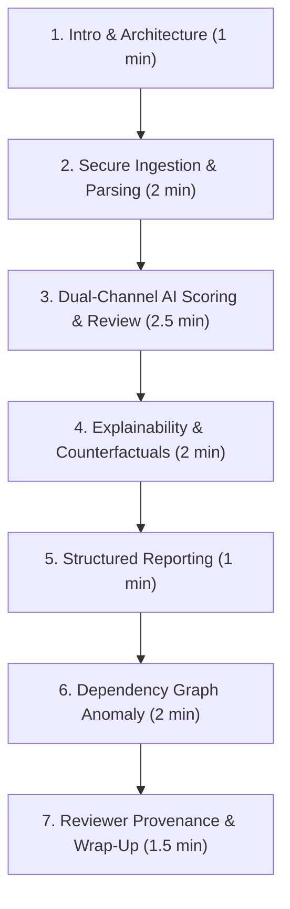

# LexAudit — Faculty Demonstration Speaking Script & Click Sequence

**Estimated Duration:** 10–12 minutes  
**Presenter:** Project Lead / Engineer  
**Role:** Senior Technical Demonstrator  
**Target Environment:** Docker Release Deployment (`http://127.0.0.1:3001` / API `http://127.0.0.1:8011`)  

---

## Executive Demonstration Outline

---

## Detailed Step-by-Step Script

### Minute 0:00 – 1:00 | Introduction & System Health

#### Exact Actions:
1. Open browser to **`http://127.0.0.1:3001`**.
2. Point out the green status badge in the header: **`online`**.
3. Point to the **Connection** fields:
   - API URL: `http://127.0.0.1:8011`
   - API Key input (masked password field).
4. Click **"Sign in / Refresh saved documents"** in the **Session and reports** panel.

#### Spoken Narrative:
> *"Respected faculty members, today we present **LexAudit**—a Legal Contract Coherence Auditor designed to assist human reviewers in pinpointing structural incongruities, semantic drift, and broken cross-references within legal agreements.*
>
> *Before we begin, I want to emphasize our core design philosophy: LexAudit is **not** an autonomous legal replacement. It does not certify contract validity or offer legal counsel. Instead, it functions as an intelligent review-prioritization system.*
>
> *As you can see on screen, our production Docker stack is fully operational. The frontend is running at port 3001, communicating through an Nginx ingress reverse proxy at port 8011 with our containerized FastAPI backend and PostgreSQL database. The backend health indicator confirms our local AI models are initialized and ready in memory."*

---

### Minute 1:00 – 3:00 | Secure Ingestion & Clause Boundary Parsing

#### Exact Actions:
1. Under **`1. Upload & Ingest`**, tick the checkbox:  
   ☑ *"I acknowledge that documents are processed locally and encrypted at rest."*
2. Click **Choose File** and select:  
   `demo_ready/LexAudit_Clean_Synthetic_Contract.txt`.
3. Click the button: **"Parse and preview clauses"**.
4. Scroll through the generated clause preview table.

#### Spoken Narrative:
> *"LexAudit enforces strict confidentiality: documents are parsed locally, encrypted at rest using Fernet authenticated encryption, and never transmitted to external cloud APIs.*
>
> *We first ingest our clean synthetic contract. Notice that before running any neural inference, LexAudit executes a deterministic clause segmentation pipeline. It identifies numbered legal headings, extracts 6 distinct clauses, and establishes character start and end offsets.*
>
> *This guarantees full provenance and traceability: every anomaly flagged downstream can be mapped back to exact character offsets in the original document."*

---

### Minute 3:00 – 5:30 | Dual-Channel AI Scoring & Review Workspace

#### Exact Actions:
1. Click **"Analyze this parsed document"**.
2. Wait 2–3 seconds while the progress indicator reflects local CPU inference.
3. Once the screen transitions to **`2. Coherence Heatmap & Findings`** (Contract Review Workspace):
   - Highlight the top KPI bar: **Total Clauses: 6**, **Review Flags: 0**, **Mean Score: ~0.340**.
   - Click on **Clause 1** (Definitions), then **Clause 2** (Scope of Services), then **Clause 4** (Confidentiality).
   - Show the right-hand **Clause Detail Panel** with score breakdown and calibration notes.

#### Spoken Narrative:
> *"Now we run real local AI analysis. In less than 3 seconds on standard CPU hardware, our dual-channel scoring engine processes the document.*
>
> *The engine evaluates two independent signals:*
> 1. * **Channel A (Global Semantic Coherence):** Compares clause embeddings from our fine-tuned Legal-BERT model against legal archetype centroids to detect topic drift.*
> 2. * **Channel B (Adjacent Clause Transition):** Measures semantic continuity between neighboring provisions.*
>
> *In this clean baseline contract, all 6 clauses score below the anomaly threshold (~0.34 vs. threshold ~0.60), resulting in zero review flags and a 'CLEAN / Low Risk' assessment.*
>
> *Crucially, our scores are calibrated priority metrics—they inform the auditor where to focus attention first, without making artificial binary claims."*

---

### Minute 5:30 – 7:30 | Explainability (XAI) & Counterfactual Repositioning

#### Exact Actions:
1. In the secondary navigation bar, click **`3. Explainability (XAI)`**.
2. Show the **Token Attribution** view:
   - Highlight word-level salience scores indicating which contractual terms contributed to the clause's coherence profile.
3. Switch to the **Neighbor Sensitivity** sub-tab.
4. Return to the review panel and point out **Counterfactual Repositioning**:
   - Show the evaluated sequence positions and delta improvements.

#### Spoken Narrative:
> *"For high-stakes legal review, black-box AI is unacceptable. In Tab 3, LexAudit exposes our Explainability layer.*
>
> *Here, token-level salience attribution visualizes exactly which terms influence coherence scores. In our neighbor sensitivity analysis, we evaluate how altering surrounding context shifts the clause's score.*
>
> *Furthermore, our experimental counterfactual engine evaluates alternate clause positions across the agreement. It answers: 'Would this clause be more coherent if relocated elsewhere?' without ever silently altering or rewriting the user's contract."*

---

### Minute 7:30 – 8:30 | Analytics Dashboard & Exporting Reports

#### Exact Actions:
1. Click **`Analytics & Findings`** in the left sidebar navigation.
   - Point out the distribution histogram and risk categorization charts.
2. In the **Session and reports** card at the top:
   - Click **"Download PDF report"**.
   - Click **"Download DOCX report"**.
3. Open or display the downloaded PDF (`LexAudit_Clean_Report.pdf`).

#### Spoken Narrative:
> *"The Analytics workspace provides high-level aggregation: distribution of risk, score dispersion, and clause-type categorization across the document.*
>
> *From here, reviewers can export standardized audit reports. LexAudit generates publication-grade PDF and editable DOCX formats directly from the saved session. Each report includes complete clause breakdown, scoring evidence, reviewer provenance, and documented legal limitations."*

---

### Minute 8:30 – 10:30 | Experimental Dependency Graph & Directional Defect

#### Exact Actions:
1. In the sidebar, click **`Overview`** (Tab 1: `Upload & Ingest`).
2. Verify privacy consent checkbox is checked.
3. Select `demo_ready/LexAudit_Broken_Directional_Reference.txt`.
4. Click **"Parse and preview clauses"**, then click **"Analyze this parsed document"**.
5. Once complete, under **Session and reports**, expand the accordion: **"Experimental dependency graph"**.
6. Check the box: ☑ *"I opt in to experimental dependency checks"*.
7. Click **"Run dependency checks"**.
8. Show the resulting evidence card:
   - **Finding:** `doc_..._1`: `"Section 4 above"`
   - **Status:** `VERIFIED_TEXTUAL_CONFLICT`
   - **Reason:** `"Explicit directional reference contradicts the target's location."`

#### Spoken Narrative:
> *"Now let us demonstrate how LexAudit handles structural cross-reference defects.*
>
> *In this synthetic contract, Section 2 states: 'Under Section 4 above, Example Party A must issue the payment notice...' However, Section 4 physically appears two sections *after* Section 2.*
>
> *When we run our experimental dependency graph checker, the system resolves the reference target ('Section 4') and analyzes the directional qualifier ('above'). Because the target is positioned at index 3 while the reference is at index 1, LexAudit deterministically identifies a `VERIFIED_TEXTUAL_CONFLICT`.*
>
> *Notice our scientific discipline: this rule-based check is explicitly opt-in and does not artificially manipulate the neural model's ensemble scores."*

---

### Minute 10:30 – 12:00 | Reviewer Feedback, History & Closing

#### Exact Actions:
1. Click **`4. Reviewer Feedback`** in the sidebar.
2. Set fields:
   - **Verdict:** `CONFIRM_ANOMALY`
   - **Reviewer Signature ID:** `faculty_demo_qa`
   - **Provenance:** `SYNTHETIC_TEST`
3. Click **"Submit Feedback to API"**.
   - Show success notification with generated `feedback_id`.
4. Expand **"Saved documents"** under Session and reports, and click **"Reopen analysis"** on a previous document to demonstrate encrypted session recall.

#### Spoken Narrative:
> *"Finally, LexAudit incorporates human-in-the-loop governance. A legal auditor can record verification verdicts—confirming or rejecting anomalies—stamped with cryptographically trackable reviewer signatures and explicit provenance tags like 'SYNTHETIC_TEST'.*
>
> *These records are preserved for offline model recalibration and audit compliance, rather than causing unpredictable online weight mutations.*
>
> *All analyzed documents remain securely cached in encrypted storage and can be reopened instantly across reviewer sessions.*
>
> *To summarize: LexAudit demonstrates a complete, hardened, local-first legal NLP pipeline covering multi-format parsing, dual-channel coherence scoring, explainability, dependency validation, and structured audit reporting. Thank you, and we welcome your questions."*

---

## Faculty Q&A Anticipated Questions & Answers

| Question | Recommended Response |
| :--- | :--- |
| **"Why didn't the AI flag the clean contract as anomalous?"** | *"That is the expected, correct behavior. The clean contract is grammatically and structurally coherent, with low semantic divergence. Fabricating flags on clean documents would represent false positives."* |
| **"Is the model 95% accurate on real contracts?"** | *"We do not claim 95% real-world legal accuracy. Our evaluation metrics reflect synthetic benchmarks and regression suites. Real legal contracts require human domain expertise, which is why LexAudit is built as an auditor-assist tool."* |
| **"Why is the directional reference check called 'experimental'?"** | *"Because deterministic rule-based section matching can struggle with complex, nested legal numbering (e.g., 'Section 4.2(a)(ii)'). We maintain transparency by labeling heuristic modules as experimental."* |
| **"Does reviewer feedback update the model weights immediately?"** | *"No, by design. In production legal environments, online weight updates risk catastrophic forgetting and prompt-injection poisoning. Feedback is stored for offline validation and governed retraining."* |
