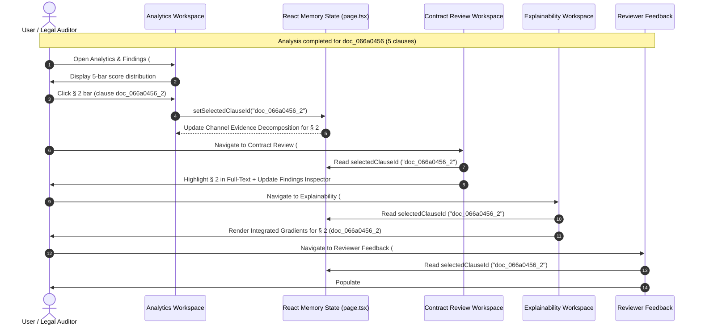

# LexAudit Phase 4A — Cross-Workspace Selection & State Synchronization Validation

## 1. Architectural Design & State Flow
Cross-workspace selection integrity in LexAudit is architected around a single authoritative React memory state variable located in [frontend/src/app/page.tsx](file:///f:/projects/nlp/Legal-contract-coherence-auditor-/frontend/src/app/page.tsx):
```typescript
const [selectedClauseId, setSelectedClauseId] = useState<string>("");
```

This single source of truth is passed down to all audit workspaces:
1. **Contract Review Workspace** ([ContractReviewWorkspace.tsx](file:///f:/projects/nlp/Legal-contract-coherence-auditor-/frontend/src/components/review/ContractReviewWorkspace.tsx))
2. **Analytics & Findings Workspace** ([AnalyticsWorkspace.tsx](file:///f:/projects/nlp/Legal-contract-coherence-auditor-/frontend/src/components/analytics/AnalyticsWorkspace.tsx))
3. **Diagnostic Explainability (XAI)** (`page.tsx` tab 3)
4. **Reviewer Feedback Workspace** (`page.tsx` tab 4)

---

## 2. End-to-End State Trajectory Test



---

## 3. CDP Browser Automated Verification Record
During automated verification ([run_phase4a_browser_verification.py](file:///f:/projects/nlp/Legal-contract-coherence-auditor-/scripts/run_phase4a_browser_verification.py)):

| Verification Step | Target Clause ID | Action | Observed Result | Status |
| :--- | :--- | :--- | :--- | :--- |
| **Selection in Analytics** | `doc_066a0456_2` | Click bar `[data-clause-id="doc_066a0456_2"]` | Bar highlighted with active glow; context strip updated to § 2. | **PASS** |
| **Contract Review Sync** | `doc_066a0456_2` | Click `#nav-contract-review` | `.findings-inspector` header displayed `doc_066a0456_2` with verified text preview. | **PASS** |
| **Explainability Sync** | `doc_066a0456_2` | Click `#nav-explainability` | XAI panel rendered: `Selected Clause: § 2 (doc_066a0456_2)`. | **PASS** |
| **Feedback Sync** | `doc_066a0456_2` | Click `#nav-feedback` | Select dropdown `#clause-select-fb` matched `doc_066a0456_2`. | **PASS** |

---

## 4. Redundant Analysis & Storage Protections
- **Zero Redundant Analysis**: Switching between sections does not trigger `/v1/upload` or `/v1/analyze`. The pipeline is called exclusively upon initial ingestion.
- **Zero Storage Leakage**: Clause IDs, full text, and audit reports are never written to `localStorage` or `sessionStorage` (verified via CDP Runtime evaluation).
- **Navigation Safety**: Deep link buttons (e.g. `#analytics-inspect-review-btn`) invoke `onNavigateToReview` which switches `activeSection` without altering memory state.
