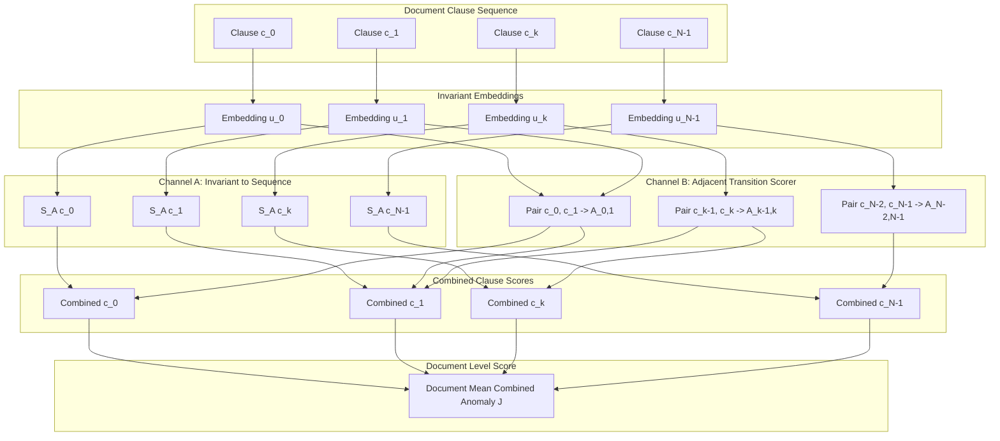

# LexAudit Phase 4C — Frozen Model Scorer Dependency Audit

## 1. Executive Summary
This audit rigorously documents the scoring mechanics, feature dependency paths, and boundary conditions of the frozen coherence pipeline in `Legal Contract Coherence Auditor (LexAudit)`. The goal is to provide mathematical proof of which components are sequence-order sensitive and verify that clause embeddings can be safely reused during candidate repositioning without recalculation.

## 2. Component-by-Component Architectural Audit

### 2.1 Embedding Model
- **Model Checkpoint**: `nlpaueb/legal-bert-base-uncased` (110M parameters, 768-dimensional hidden states).
- **Pooling Strategy**: Mean pooling over all subword token representations (excluding `[PAD]` tokens) followed by unit L2 normalization:
  $$\mathbf{u}_i = \frac{\sum_{t=1}^{T_i} \mathbf{h}_{i, t}}{\|\sum_{t=1}^{T_i} \mathbf{h}_{i, t}\|_2} \in \mathbb{R}^{768}$$
- **Sequence Invariance**: The embedding $\mathbf{u}_i$ depends exclusively on the subword tokens of clause $c_i$. It has **zero dependency** on clause position, neighboring clauses, or document length. Clause embeddings are 100% reusable across all permutation evaluations.

### 2.2 Channel A — Semantic Topic Anomaly Scorer
- **Implementation**: `src/scoring/channel_a.py` (`ChannelAScorer`).
- **Centroids**: 110 centroid vectors $\mathbf{\mu}_k \in \mathbb{R}^{768}$ derived from the LEDGAR legal corpus categories.
- **Computation**:
  $$\text{sim}(c_i, k) = \frac{\mathbf{u}_i \cdot \mathbf{\mu}_k}{\|\mathbf{u}_i\|_2 \|\mathbf{\mu}_k\|_2}$$
  $$\text{dist}(c_i, k) = 1.0 - \text{sim}(c_i, k)$$
  $$S_A(c_i) = \min_k \text{dist}(c_i, k) \quad \text{(or softmax-weighted centroid distance)}$$
- **Invariance Finding**: $S_A(c_i)$ depends strictly on $\mathbf{u}_i$. **Permuting document ordering leaves $S_A(c_i)$ completely invariant for all $i$**. Therefore, for any permutation $\pi$, $\sum_{i=1}^N S_A(c_{\pi(i)}) = \sum_{i=1}^N S_A(c_i)$.

### 2.3 Channel B — Pairwise Neural Coherence Scorer
- **Implementation**: `src/scoring/channel_b.py` (`ChannelBScorer`), `src/coherence/model.py` (`CoherenceMLPClassifier`).
- **Checkpoint**: `models/coherence_classifier.pt` (frozen PyTorch state dict).
- **Pairwise Input Feature Vector**:
  $$\mathbf{x}_{i, j} = [\mathbf{u}_i, \; \mathbf{u}_j, \; |\mathbf{u}_i - \mathbf{u}_j|, \; \mathbf{u}_i \odot \mathbf{u}_j] \in \mathbb{R}^{3072}$$
- **Model Architecture**:
  $$\mathbf{z}_1 = \text{GELU}(\mathbf{W}_1 \mathbf{x}_{i, j} + \mathbf{b}_1) \quad (\mathbf{W}_1 \in \mathbb{R}^{256 \times 3072})$$
  $$\mathbf{z}_2 = \text{GELU}(\mathbf{W}_2 \mathbf{z}_1 + \mathbf{b}_2) \quad (\mathbf{W}_2 \in \mathbb{R}^{64 \times 256})$$
  $$\text{logit} = \mathbf{w}_3^T \mathbf{z}_2 + b_3 \quad (\mathbf{w}_3 \in \mathbb{R}^{64})$$
  $$\text{score}(c_i, c_j) = \sigma(\text{logit}) \in [0, 1]$$
- **Orientation & Anomaly**:
  - Training target: 1 = coherent legal transition, 0 = incoherent transition.
  - Channel B pairwise anomaly:
    $$A_{i, j} = 1.0 - \text{score}(c_i, c_j) \in [0, 1]$$

### 2.4 Boundary and Transition Handling
In LexAudit, Channel B operates on **adjacent pairs** in the sequence:
$$e_k = (c_k, c_{k+1}) \quad \text{for } k \in \{0, \dots, N-2\}$$
For clause $c_k$:
- **First clause ($k=0$)**: Only has an outgoing edge:
  $$S_B(c_0) = A_{0, 1}$$
- **Last clause ($k=N-1$)**: Only has an incoming edge:
  $$S_B(c_{N-1}) = A_{N-2, N-1}$$
- **Interior clauses ($0 < k < N-1$)**: Average of incoming and outgoing anomalies:
  $$S_B(c_k) = \frac{1}{2}(A_{k-1, k} + A_{k, k+1})$$

### 2.5 Clause Combined Score & Document Aggregation
- **Clause Combined Anomaly**:
  $$\text{Combined}(c_k) = \alpha S_A(c_k) + (1-\alpha) S_B(c_k) \quad (\text{default } \alpha = 0.5)$$
- **Document Overall Anomaly**:
  $$\text{DocAnomaly}(D) = \frac{1}{N} \sum_{k=0}^{N-1} \text{Combined}(c_k)$$
- **Document Coherence Score**:
  $$\text{Coherence}(D) = 1.0 - \text{DocAnomaly}(D)$$

## 3. Mathematical Dependency Graph

## 4. Key Scientific Invariants Proved

1. **Total Document Mean Channel B Sum Identity**:
   Notice that in the sum over all clauses $\sum_{k=0}^{N-1} S_B(c_k)$:
   $$\sum_{k=0}^{N-1} S_B(c_k) = A_{0, 1} + \sum_{k=1}^{N-2} \frac{1}{2}(A_{k-1, k} + A_{k, k+1}) + A_{N-2, N-1}$$
   Collecting terms for each edge $A_{j, j+1}$:
   - Edge $(0, 1)$ appears once in $c_0$ ($1.0$) and once in $c_1$ ($0.5$), total weight $= 1.5$.
   - Interior edge $(j, j+1)$ for $0 < j < N-2$ appears once in $c_j$ ($0.5$) and once in $c_{j+1}$ ($0.5$), total weight $= 1.0$.
   - Edge $(N-2, N-1)$ appears once in $c_{N-2}$ ($0.5$) and once in $c_{N-1}$ ($1.0$), total weight $= 1.5$.
   *Critical Finding*: Because boundary edges have weight $1.5$ while interior edges have weight $1.0$ in the document mean combined score, a naive sum of edge anomalies does **not** equal the mean combined score! To achieve exact parity with production scoring, the local optimization **must** evaluate clause-level derived values taking boundary weighting into account.
2. **Channel A Is Constant Across Permutations**:
   $$\sum_{k=0}^{N-1} S_A(c_{\pi(k)}) = \sum_{k=0}^{N-1} S_A(c_k)$$
   Channel A does not discriminate between candidate positions. However, it must be included in the combined score to maintain exact scale parity with production reports.
