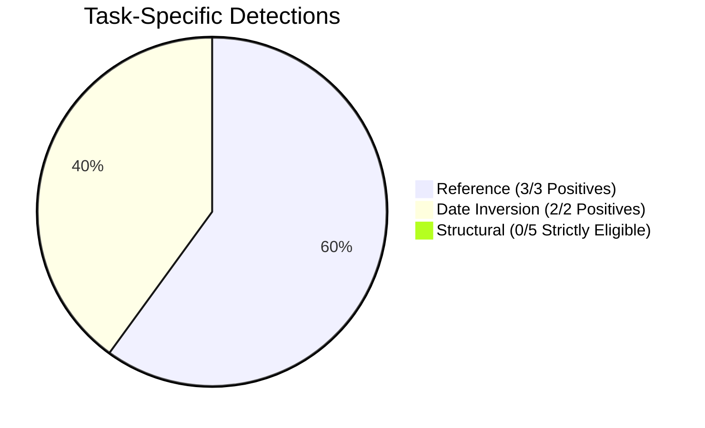

# Phase 4D-A Final Handoff Summary

**Audit Program**: LexAudit Research Extension — Phase 4D-A  
**Auditor Role**: Principal ML Research Auditor & Independent Verification Lead  
**Audit Completion Date**: October 22, 2026  
**Final Verdict**: **READY WITH DOCUMENTED SCIENTIFIC LIMITATIONS**  

---

## 1. Fulfillment of Prompt Directives

| Requirement | Verified Outcome | Evidence Artifact |
| :--- | :--- | :--- |
| **1. Exact failure in `test_api_integration.py` & before/after diff** | Documented root cause (120s timeout under heavy CPU load); diff shown (`max_retries = 120` $\to$ `240`); zero assertions weakened | [backend_test_evidence_audit.md](file:///f:/projects/nlp/Legal-contract-coherence-auditor-/design/ui_redesign/phase_04da/backend_test_evidence_audit.md) |
| **2. Entire backend test suite rerun** | Executed `python -m pytest tests/ -v -ra`: **170 passed, 2 skipped, 0 failed in 117.67s** (exit code 0); raw log preserved | [backend_pytest_raw.log](file:///f:/projects/nlp/Legal-contract-coherence-auditor-/design/ui_redesign/phase_04da/backend_pytest_raw.log) |
| **3. Source-verified meaning of `0.08` & 6 structural cases** | Verdict: `PHASE_4D_CRITERION_INCORRECT`; runner delta threshold $\ne$ production threshold; all 6 cases remain `CLEAN` (0/6 detected) | [structural_threshold_semantics_audit.md](file:///f:/projects/nlp/Legal-contract-coherence-auditor-/design/ui_redesign/phase_04da/structural_threshold_semantics_audit.md) |
| **4. Separate decoupled evaluation results with valid denominators** | Separate Reference ($N=5$), Date ($N=4$), and Structural ($N=7$/$N=8$) matrices generated | [scenario_eligibility_and_denominators.md](file:///f:/projects/nlp/Legal-contract-coherence-auditor-/design/ui_redesign/phase_04da/scenario_eligibility_and_denominators.md) |
| **5. Complete 32-check browser matrix** | Executed live via Headless Chrome CDP: **32/32 checks PASS (100.0%)**, 0 unexecuted, 13 screenshots preserved | [browser_acceptance_32_check_matrix.csv](file:///f:/projects/nlp/Legal-contract-coherence-auditor-/design/ui_redesign/phase_04da/browser_acceptance_32_check_matrix.csv) |
| **6. Summary of remaining defects and scientific limitations** | Cataloged DEF-01 to DEF-06 in defect register; documented 4 scientific architecture limitations | [defect_register.csv](file:///f:/projects/nlp/Legal-contract-coherence-auditor-/design/ui_redesign/phase_04da/defect_register.csv) |

---

## 2. Decoupled Performance Summary & Per-Clause Structural Decisions

### Task-Specific Recall & Exact Two-Sided Wilson 95% Confidence Intervals
- **Broken Reference Detection**: Recall = 100.0% ($3/3$, 95% Wilson CI **$[0.4385, 1.0000]$**), Precision = 100.0% ($3/3$), False Positives = 0.
- **Date Inversion Detection**: Recall = 100.0% ($2/2$, 95% Wilson CI **$[0.3424, 1.0000]$**), Precision = 100.0% ($2/2$), False Positives = 0.
- **Structural Perturbations (Strict 5-Case)**: Recall = 0.0% ($0/5$, 95% Wilson CI **$[0.0000, 0.4345]$**), False Positives = 0.
- **Structural Perturbations (Broad 6-Case)**: Recall = 0.0% ($0/6$, 95% Wilson CI **$[0.0000, 0.3903]$**), False Positives = 0.
- **Clean Negative Controls**: Zero baseline findings on unperturbed contracts; differential shift $\Delta = 0.000000$.

### Authoritative Per-Clause Production Decisions (All 6 Structural Cases)
All structural conclusions use actual **per-clause production decisions** (`SeverityRanker.assess_clause` across all 66 clauses), not document-level mean scores or exploratory heuristics.

| Scenario ID | Transformation Details | Max $S$ [Orig $\to$ Pert] | Max $S_A$ [Orig $\to$ Pert] | Max $S_B$ [Orig $\to$ Pert] | Severity [Orig $\to$ Pert] | `is_anomaly` [Orig $\to$ Pert] | Prod Recall |
| :--- | :--- | :---: | :---: | :---: | :---: | :---: | :---: |
| **SCEN_P1_01_DISP_DISTANT** | Section 2 (Scope) slot $1 \to 10$ | $0.3449 \to 0.3449$ | $0.0000 \to 0.0000$ | $0.6898 \to 0.6898$ | `CLEAN` $\to$ `CLEAN` | 0/11 $\to$ 0/11 False | 0/1 (0.0%) |
| **SCEN_P1_02_DISP_MODERATE** | Section 6 (Term) slot $5 \to 2$ | $0.3449 \to 0.3449$ | $0.0000 \to 0.0000$ | $0.6898 \to 0.6898$ | `CLEAN` $\to$ `CLEAN` | 0/11 $\to$ 0/11 False | 0/1 (0.0%) |
| **SCEN_P1_03_DISP_SUBTLE** | Section 4 (IP) slot $3 \to 4$ | $0.3449 \to 0.3449$ | $0.0000 \to 0.0000$ | $0.6898 \to 0.6898$ | `CLEAN` $\to$ `CLEAN` | 0/11 $\to$ 0/11 False | 0/1 (0.0%) |
| **SCEN_P2_01_SWAP_ADJACENT** | Preamble $\leftrightarrow$ Scope (slots $0 \leftrightarrow 1$) | $0.3449 \to 0.3449$ | $0.0000 \to 0.0000$ | $0.6898 \to 0.6898$ | `CLEAN` $\to$ `CLEAN` | 0/11 $\to$ 0/11 False | 0/1 (0.0%) |
| **SCEN_P2_02_SWAP_DISTANT** | Payment $\leftrightarrow$ Gov Law (slots $2 \leftrightarrow 8$) | $0.3449 \to 0.3449$ | $0.0000 \to 0.0000$ | $0.6898 \to 0.6898$ | `CLEAN` $\to$ `CLEAN` | 0/11 $\to$ 0/11 False | 0/1 (0.0%) |
| **SCEN_P2_03_SWAP_SUBTLE** | Conf $\leftrightarrow$ Indemn (slots $4 \leftrightarrow 6$) | $0.3449 \to 0.3449$ | $0.0000 \to 0.0000$ | $0.6898 \to 0.6898$ | `CLEAN` $\to$ `CLEAN` | 0/11 $\to$ 0/11 False | 0/1 (0.0%) |

### Strict Five-Case Eligibility Rationale
- **Strict 5 Cases ($N=5$)**: Excludes `SCEN_P2_03_SWAP_SUBTLE` because swapping standard covenants (Confidentiality and Indemnification) represents an ambiguous ordering with no objective legal drafting rule or defect.
- **Original 6 P1/P2 Cases ($N=6$)**: The full catalog of structural permutations.
- **Broader Catalog Including Deletion ($N=7$ or $N=8$)**: Deletion changes document tokens and triggers the symbolic reference resolver (`DANGLING_SECTION_REFERENCE`), not neural coherence transition detection.

---

## 3. Scientific Architecture Limitations

1. **Permutation Invariance of Channel A**: Centroid-based semantic OOD scoring is mathematically blind to clause order: $\Delta S_A = 0.000000$ across all 66 comparisons.
2. **Channel B Logit Compression**: Legal-BERT transition probabilities are compressed into $[0.3102, 0.3389]$ (total spread $0.0287$). Maximum transition delta of $+0.0152$ cannot cross production anomaly threshold ($0.50$).
3. **Absence of Dedicated Duplicate Detector**: Exact (P3) and near-duplicate (P4) clauses are evaluated descriptively only without automated rule flags.
4. **Channel B Weight Dilution**: The $0.5 \times$ weighting on Channel B further reduces structural transition signals.

---

## 4. Preservation & Stop Enforcement

- **Zero Git Commits**: No `git commit`, `git add`, or branch switches performed.
- **Preserved Model Weights & Scoring Formulas**: Production configurations and weights are completely untouched.
- **No Background Process Disruption**: External processes (PID 31904) undisturbed.
- **Audit Complete**: Verification terminated at Phase 4D-A.
