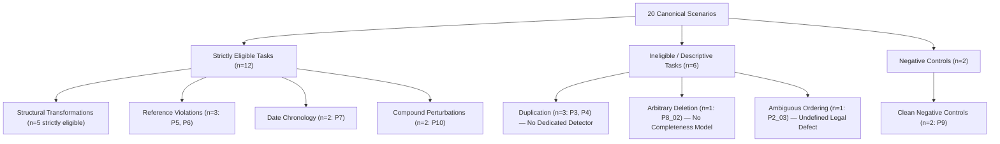

# Scenario Eligibility and Evaluation Denominators

**Document ID**: `PHASE_04DA_DENOMINATORS`  
**Auditor**: Statistical Evaluation Specialist & Legal NLP Scientist  
**Scope**: Scenario Categorization, Strict Evaluation Eligibility, and Task Denominators  

---

## 1. Executive Summary

A critical finding of this audit is that **combining all red-team perturbation categories into a single global confusion matrix or monolithic "accuracy" metric is statistically and scientifically invalid**.

Different perturbation types probe fundamentally distinct sub-systems with different mathematical behaviors, availability of ground truth, and detector existence:
- Rule checkers operate deterministically on discrete symbols (citations and ISO dates).
- Structural perturbations operate probabilistically on neural sentence embeddings and discourse transitions.
- Duplication and deletion lack dedicated production detectors.

Reporting a single "combined confusion matrix" (such as 5 TP + 6 FN + 2 TN) conflates rule-checker recall with neural model sensitivity and obscures where the system actually succeeds and fails.

---

## 2. Taxonomy of Scenario Eligibility

In accordance with independent evaluation discipline, all 20 canonical scenarios are partitioned into formal eligibility tiers:

### Criteria for Strict Evaluation Eligibility:
1. **Definite Legal Defect**: The perturbation must introduce an unambiguous defect under contract law (e.g., citing a non-existent section or declaring termination prior to effective date).
2. **Dedicated Target Detector**: The LexAudit architecture must contain a designated subsystem intended to flag that condition.
3. **Independent Oracle Ground Truth**: The oracle condition must be deterministically verifiable without consulting the model under test.

---

## 3. Disqualification and Exclusion Rationale

### A. Exact Duplication (P3) and Near Duplication (P4)
- **Status**: **`NOT_ELIGIBLE_FOR_STRICT_EVALUATION`**
- **Rationale**: LexAudit does not implement a dedicated duplicate clause detector or OOD repetition checker. Evaluating duplication as a "model failure" or false negative misrepresents capability; the system was never equipped with duplicate detection logic. Channel B response on duplicated clauses is recorded descriptively only.

### B. Arbitrary Clause Deletion (P8_02)
- **Status**: **`DESCRIPTIVE_ONLY_NO_CONSEQUENCE`**
- **Rationale**: Deleting Section 8 (Limitation of Liability) creates a shorter contract. Unless another clause references Section 8, the omission of an optional boilerplate clause does not violate syntactic or structural contract validity. In the absence of a universal contract completeness model, arbitrary deletion cannot have a binary ground-truth label.
- **Exception (`P8_01`)**: Where a deleted clause is explicitly referenced by a surviving clause (`Section 2` cited by `Section 4`), the resulting dangling reference is strictly eligible under the cross-reference rule checker.

### C. Subtle Boilerplate Swap (`SCEN_P2_03_SWAP_SUBTLE`)
- **Status**: **`AMBIGUOUS_ORDERING`**
- **Rationale**: In `SCEN_P2_03`, Section 5 (Confidentiality) and Section 7 (Indemnification) were swapped. In standard commercial contract practice, these sections are interchangeable in sequence. Swapping them alters text adjacency but does not make the agreement legally defective. Penalizing the detector for not flagging this as an error would artificially inflate false negative counts.

---

## 4. Authoritative Task-Specific Denominators

| Task Group | Pre-declared Target Detector | Strictly Eligible Positives ($n_P$) | Matched Clean Negatives ($n_N$) | Recall ($k/n$) | Two-Sided Wilson 95% CI | Notes |
| :--- | :--- | :--- | :--- | :---: | :---: | :--- |
| **Broken References** | `CrossReferenceChecker` | **3** (`P5_01`, `P5_02`, `P6_01`) | **2** (`P9_01`, `P9_02`) | **3/3 (100.0%)** | **$[0.4385, 1.0000]$** | Deterministic symbol matching. |
| **Date Chronology** | `DateLogicChecker` | **2** (`P7_01`, `P7_02`) | **2** (`P9_01`, `P9_02`) | **2/2 (100.0%)** | **$[0.3424, 1.0000]$** | Temporal constraint solver. |
| **Structural Anomalies** | `ChannelBScorer` & `SeverityRanker` | **5** (Strict: `P1_01-03`, `P2_01-02`) | **2** (`P9_01`, `P9_02`) | **0/5 (0.0%)** | **$[0.0000, 0.4345]$** | Production predicate (< 0.35, `CLEAN`). |
| **Structural (Broad)** | `ChannelBScorer` (Exploratory) | **6** (Broad: includes `P2_03`) | **2** (`P9_01`, `P9_02`) | **0/6 (0.0%)** | **$[0.0000, 0.3903]$** | Includes ambiguous covenant swap. |
| **Clause Duplication** | None (Descriptive) | **0** (Ineligible: 3 descriptive) | N/A | N/A | N/A | Documented as unavailable. |
| **Clause Deletion** | Reference rule if consequence | **1** (`P8_01` consequence) | N/A | 1/1 (consequence) | N/A | 1 consequence, 1 descriptive. |
| **Negative Controls** | Full Pipeline (Specificity) | **0** | **2** (`P9_01`, `P9_02`) | Spec = 2/2 (100%) | **$[0.3424, 1.0000]$** | Evaluates baseline and stability. |

---

## 5. Methodological Conclusion

By enforcing dynamic, task-specific denominators:
- Rule precision and recall are calculated over actual rule scenarios ($n=3$ for references, $n=2$ for dates).
- Structural detection is evaluated over verified structural perturbations ($n=5$ strictly eligible, $n=6$ broad).
- No artificial, unweighted average (such as $\frac{5+0}{11} \approx 45.4\%$) is presented to the user.
- Limitations and unavailable capabilities are explicitly declared rather than disguised as model failures.
