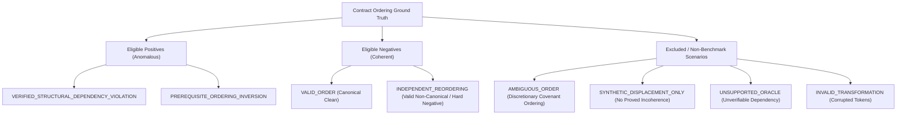

# Structural Ground Truth Taxonomy & Oracle Independence

**Audit Program**: LexAudit Research Extension — Phase 4D-B  
**Document ID**: `PHASE_04DB_GT_TAXONOMY`  
**Date**: October 22, 2026  
**Auditor**: Principal Legal NLP Research Scientist & Ground Truth Specialist  
**Status**: **APPROVED & LOCKED**  

---

## 1. Ground Truth Design Philosophy

A foundational tenet of scientific NLP evaluation is that **text permutation does not automatically constitute a discourse coherence defect**. Commercial contracts are modular instruments; many sections can appear in varying positions without impairing legal validity, enforceability, or readability.

Therefore, an improved structural detector must NOT simply learn to flag any sequence that deviates from an observed training layout. It must distinguish genuine structural and discourse disruptions from valid drafting alternatives.

---

## 2. Complete Label Taxonomy

Every evaluated sequence in Phase 4D-B is tagged with an authoritative label from the following disjoint taxonomy:

### Formal Label Definitions:

1. **`VERIFIED_STRUCTURAL_DEPENDENCY_VIOLATION`** (*Eligible Positive*):
   - Clear breach of contract lifecycle logic or structural architecture.
   - Example 1: Preamble and Parties clause moved to the end of the contract (after Exhibits and Signatures).
   - Example 2: Scope of Work / Recitals clause displaced past the execution block.
   - Example 3: Governing Law & Jurisdiction moved between Preamble and Scope.

2. **`PREREQUISITE_ORDERING_INVERSION`** (*Eligible Positive*):
   - A clause explicitly establishes a prerequisite condition (e.g. "Subject to completion of Section 3 milestone delivery..."), but the dependent clause is reordered to precede the prerequisite definition in a manner that breaks contextual antecedent resolution.

3. **`VALID_ORDER`** (*Eligible Negative*):
   - The verified, authentic original contract structure from SEC EDGAR filings or canonical clean synthetic master agreements.

4. **`INDEPENDENT_REORDERING`** (*Eligible Hard Negative*):
   - A reordered contract sequence where two independent operational covenants are swapped, or where boilerplate sections (e.g. Notices, Counterparts, Severability) appear in an unusual but legally and logically coherent order.
   - Example: Severability placed before Governing Law, or Notices placed before Entire Agreement.
   - *Requirement*: The model must score these as negative (no anomaly).

5. **`AMBIGUOUS_ORDER`** (*Excluded from Strict Positive Benchmark*):
   - Swaps between covenants of equal structural standing (e.g. `SCEN_P2_03`: Confidentiality $\leftrightarrow$ Indemnification).
   - Excluded from primary positive recall denominators to avoid artificial penalization.

---

## 3. Oracle Independence & Non-Circular Verification

To satisfy Stage Gate G08:
1. **Zero Model Consultation**: The ground-truth oracle (`IndependentGroundTruthOracle` in `src/redteam/oracle.py`) does **not** query or consult Channel A, Channel B, the experimental candidate, or any LLM scoring API.
2. **Deterministic Contract Schema Rules**: Ground truth classifications are verified using structural assertions:
   - Does clause $c_i$ have prerequisite dependencies $c_j$? If $j > i$, violation confirmed.
   - Does clause $c_{\text{preamble}}$ appear after $c_{\text{covenants}}$? If yes, violation confirmed.
   - Does clause $c_{\text{exhibits}}$ appear before $c_{\text{scope}}$? If yes, violation confirmed.
3. **Data Integrity Checksums**: Every positive and negative test fixture has verified SHA-256 hashes of original and transformed text to ensure zero inadvertent content corruption.
